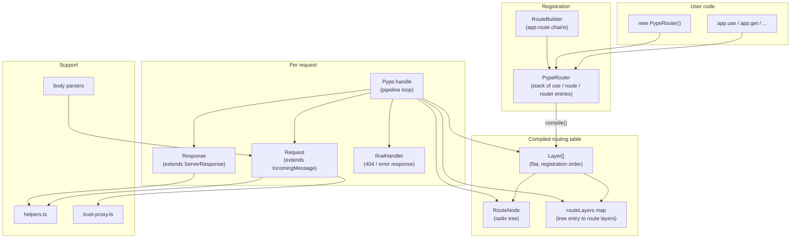
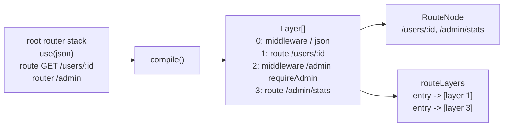
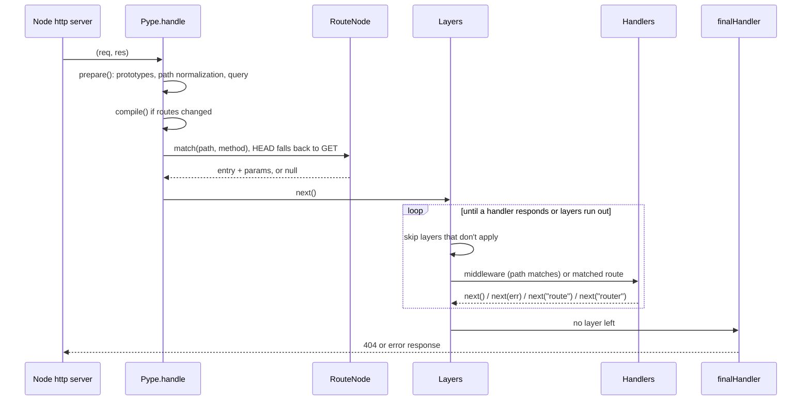
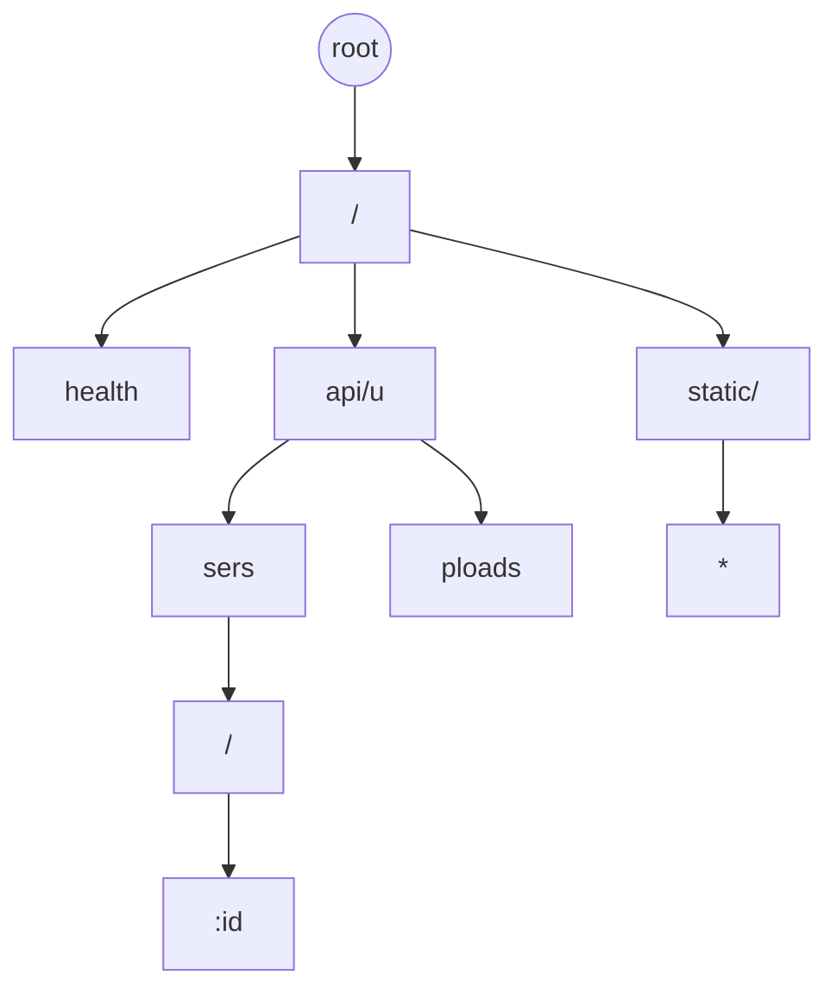
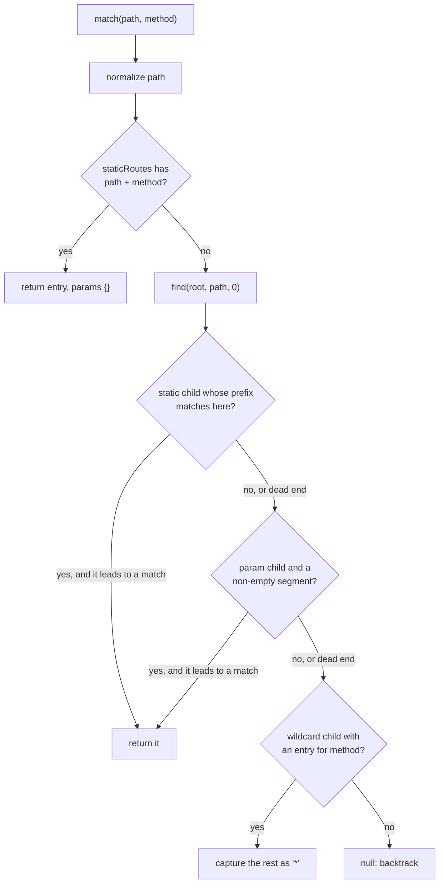
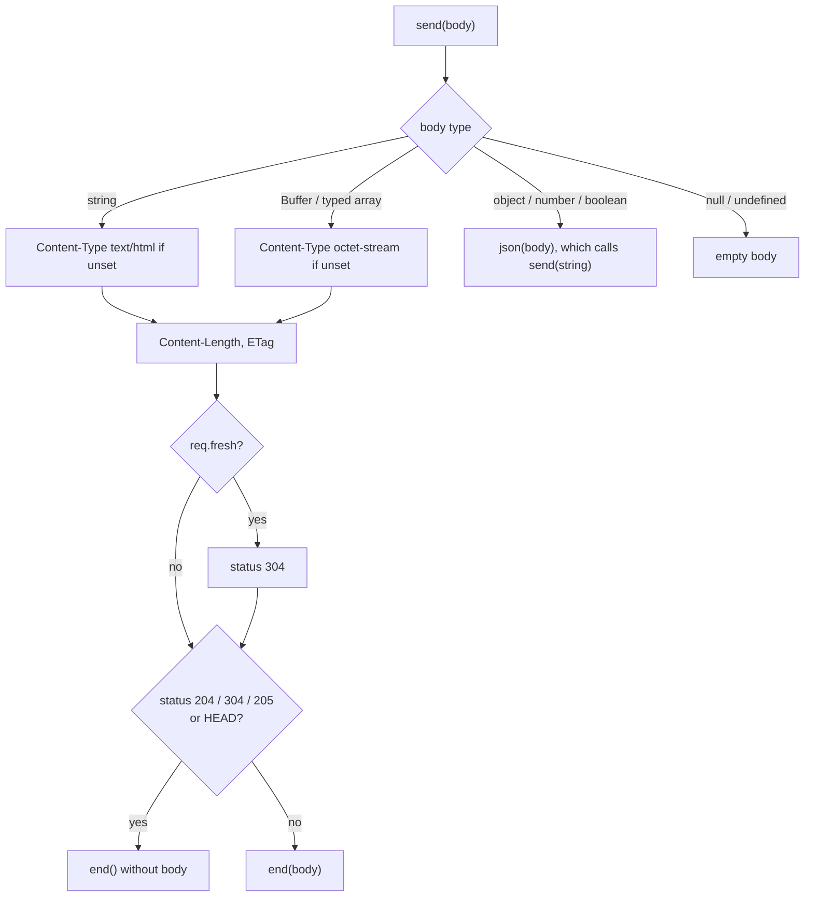
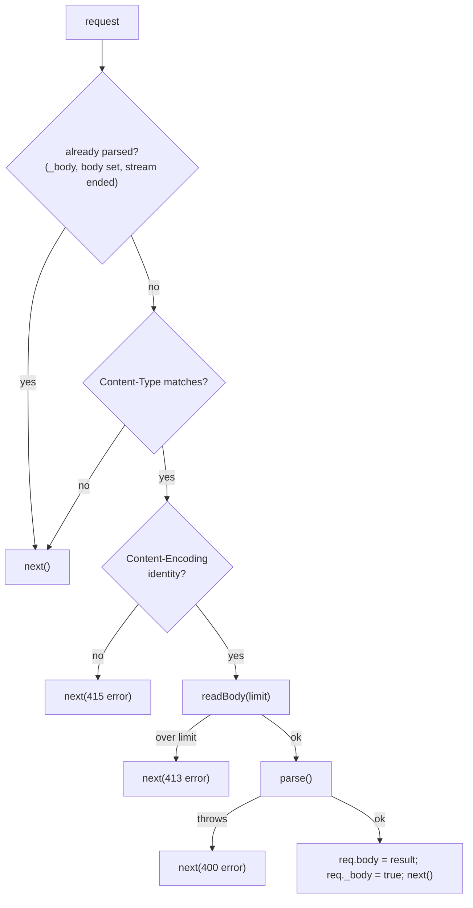

# Pype architecture

This document explains how Pype is built: which component does what, how a
request flows through them, and why the main design decisions were made. It is
written for contributors and for anyone who wants to understand the code
before changing it. For how to *use* the framework, see the
[README](../README.md).

## Contents

- [Goals](#goals)
- [Source layout](#source-layout)
- [Component overview](#component-overview)
- [Lifecycle](#lifecycle)
  - [1. Registration](#1-registration)
  - [2. Compilation](#2-compilation)
  - [3. Handling a request](#3-handling-a-request)
- [Components](#components)
  - [Pype: the application and the pipeline](#pype-the-application-and-the-pipeline)
  - [PypeRouter: the registration stack](#pyperouter-the-registration-stack)
  - [RouteNode: the radix tree router](#routenode-the-radix-tree-router)
  - [Request](#request)
  - [Response](#response)
  - [Body parsers](#body-parsers)
  - [Trust proxy](#trust-proxy)
  - [Helpers](#helpers)
  - [Types and Express compatibility](#types-and-express-compatibility)
- [Design decisions](#design-decisions)
- [Security model](#security-model)
- [Performance](#performance)
- [Testing](#testing)
- [Extending Pype](#extending-pype)
- [Known limitations](#known-limitations)

## Goals

1. **Express 5 compatibility.** Existing Express middleware and the Express
   request and response API must work without changes.
2. **Fast routing.** Route lookup must not slow down as the number of routes
   grows, unlike Express, which tests every route in turn.
3. **No runtime dependencies.** Everything Express pulls from ~60 packages is
   implemented in this repository.
4. **Safe defaults.** Parsing of untrusted input (paths, query strings, headers,
   bodies, file paths) must not crash the server or open security holes.

## Source layout

```
src/
  index.ts                  public exports
  core/
    server.ts               Pype: settings, compilation, the request pipeline
    router.ts               PypeRouter: registration stack, flattening to layers
    request.ts              Request: extends http.IncomingMessage
    response.ts             Response: extends http.ServerResponse
  utils/
    Trie-Route.ts           RouteNode: the radix tree that matches paths
    helpers.ts              negotiation, cookies, ranges, ETags, freshness, query parsing
    trust-proxy.ts          "trust proxy" setting and X-Forwarded-For handling
  middlewares/
    body-parser.ts          json(), urlencoded(), text(), raw()
  types/                    Middleware, ErrorMiddleware, NextFunction, CookieOptions, ...
  enums/
    methods.enum.ts         HTTP_METHODS
    mime-types.ts           extension to MIME type table
```

| File | Lines | Responsibility |
| ---- | ----- | -------------- |
| `core/server.ts` | ~600 | Application API, compiling routes, running the pipeline, final error handling |
| `core/response.ts` | ~650 | Everything that writes a response: `send`, `json`, `sendFile`, cookies, redirects |
| `utils/helpers.ts` | ~500 | Pure functions shared by request and response |
| `utils/Trie-Route.ts` | ~480 | Path matching |
| `core/request.ts` | ~350 | Request properties and content negotiation |
| `core/router.ts` | ~340 | Collecting middleware and routes in registration order |
| `middlewares/body-parser.ts` | ~190 | Reading and parsing request bodies |
| `utils/trust-proxy.ts` | ~85 | Deciding which proxy headers to believe |

## Component overview



There are two phases:

- **Registration** only records what the user registered, in order, on
  `PypeRouter` objects. Nothing is matched yet.
- **Compilation** turns the routers into a flat list of layers and a radix
  tree. The request pipeline only ever reads this compiled form.

## Lifecycle

### 1. Registration

Every `Pype` app owns one root `PypeRouter`. All registration methods on the
app delegate to it:

```ts
app.use(json());                 // -> router.stack: { type: "use", path: "/", handlers: [json] }
app.get("/users/:id", show);     // -> router.stack: { type: "route", path: "/users/:id", methods: ["get"], handlers: [show] }
app.use("/admin", adminRouter);  // -> router.stack: { type: "router", path: "/admin", router: adminRouter }
```

Each registration increments a module-level counter, `routingVersion()`. That
is how the app knows its compiled table is out of date, including when a
router that is already mounted gets new routes later.

### 2. Compilation

`Pype.compile()` runs in `listen()` and, if the version changed, at the start
of a request. It:

1. Calls `router.compile()`, which walks the stack recursively and produces a
   **flat array of layers in registration order**. Mount paths are joined
   (`/admin` + `/stats` becomes `/admin/stats`), and each layer records the
   chain of routers it came from.
2. Builds a fresh `RouteNode` (radix tree) and registers every route layer's
   full path in it.
3. Builds `routeLayers`, a map from the tree's entry to the route layers it
   stands for (see [why](#one-tree-entry-many-route-layers)).



Route conflicts (two different param names at the same position) throw here,
so `listen()` reports them at startup.

### 3. Handling a request



The route is looked up **once**, before the pipeline starts. While walking the
layers, a route layer runs only if it is one of the layers the tree matched.
Middleware layers are checked by a cheap prefix comparison.

## Components

### Pype: the application and the pipeline

`src/core/server.ts`

#### State

| Field | Purpose |
| ----- | ------- |
| `settings` | Express-style settings. `"trust proxy"` also stores a compiled predicate under `"trust proxy fn"`. |
| `locals` | User data shared across the app. |
| `router` | The root `PypeRouter`. |
| `layers`, `routes`, `routeLayers` | The compiled table, rebuilt by `compile()`. |
| `compiledVersion` | The `routingVersion()` the table was built from. |

#### `prepare(req, res)`

Runs first for every request:

1. **Prototype upgrade.** `listen()` creates the server with
   `createServer({ IncomingMessage: Request, ServerResponse: Response })`, so
   Node builds Pype objects directly. When Pype runs on someone else's server
   (`http.createServer(app.handler)`, supertest, HTTPS), the plain objects are
   given Pype's prototypes with `Object.setPrototypeOf`.
2. **Per-request state.** Sets `req.app`, `res.app`, `req.res`,
   `req.originalUrl`, `req.baseUrl = ""`, `req.params = {}` and `res.locals`.
3. **Path normalization.** Collapses duplicate slashes in `req.path` and
   `req.url` once. This is a security measure, see
   [Security model](#security-model).
4. **Query parsing.** Only when the URL has a `?`; the result has no
   prototype.

#### The pipeline loop: `handle()` and `next()`

`handle()` keeps an `index` into the layer array and defines `next(err?)`.
Each call to `next` advances `index` to the next layer that applies and runs
it:

| Layer kind | Runs when |
| ---------- | --------- |
| Middleware, 3 parameters | No error is pending and `req.path` is under the layer's mount path |
| Middleware, 4 parameters (error middleware) | An error is pending and the path matches |
| Route | The layer is one of the layers matched by the tree |

Signals passed to `next`:

- `next(err)`: an error is pending; normal middleware is skipped until error
  middleware handles it.
- `next("route")`: the route stops running its handlers and returns to the
  main loop, which continues with the next layer (possibly another route
  registered for the same path).
- `next("router")`: the loop skips every following layer that belongs to the
  innermost router of the layer that called it.

When no layer is left, `finalHandler()` responds.

#### `callMiddleware()` and `runRoute()`

Both implement Express's **relative paths**: before calling a middleware
mounted on `/admin`, `mount()` strips `/admin` from `req.url` and `req.path`
and appends it to `req.baseUrl`. The original values are restored when the
middleware calls `next()`.

`runRoute()` additionally:

- sets `req.params` and `req.route`;
- runs the route's own handlers in order with its own inner `next`;
- while an error is pending, only runs four-parameter handlers.

#### `invoke()`: catching errors

Every handler call goes through `invoke()`:

```ts
try {
  const result = err ? handler(err, req, res, next) : handler(req, res, next);
  if (result && typeof result.then === "function") {
    result.then(undefined, (error) => next(error ?? new Error("Rejected promise")));
  }
} catch (error) {
  next(error);
}
```

Synchronous throws and rejected promises both become `next(err)`, like
Express 5. Each `next` passed to a handler is wrapped in `once()`, so a second
call only logs a warning instead of running the rest of the pipeline twice.

#### `finalHandler()`

Mirrors Express's `finalhandler` package:

- No error and the response already started: do nothing.
- No error: `404 {"error":"Cannot GET /path","status":404}`.
- Error: status from `err.status` or `err.statusCode` (400–599, else 500).
  Only 4xx messages are exposed. Existing headers are cleared, `err.headers`
  are applied, and the error is logged unless `env` is `"test"`.
- If headers were already sent, the socket is destroyed, because the
  response can't be completed meaningfully.

### PypeRouter: the registration stack

`src/core/router.ts`

A router is just an ordered list of entries:

```ts
type StackEntry =
  | { type: "use"; path; handlers }       // middleware
  | { type: "router"; path; router }      // a mounted sub-router
  | { type: "route"; path; methods; handlers };
```

- `use()` flattens nested arrays (Express allows `use([a, [b, c]])`), splits
  a mixed list like `use("/x", mw, router, mw2)` into consecutive entries, and
  validates that every argument is a function or a router.
- The route methods (`get`, `post`, ..., `all`) flatten handler arrays and
  push a `route` entry.
- `route(path)` returns a `RouteBuilder`, a thin object whose methods call
  the router's methods with the stored path.

`compile(basePath, routers)` produces the layers:

```ts
interface MiddlewareLayer { kind: "middleware"; path; handle; routers }
interface RouteLayer {
  kind: "route";
  fullPath;   // used for matching, e.g. "/admin/stats"
  routePath;  // as written, e.g. "/stats", exposed as req.route.path
  baseUrl;    // mount path, e.g. "/admin", exposed as req.baseUrl
  methods; handlers; routers;
}
```

`routers` is the chain of routers a layer came from, outermost first. It is
what lets `next("router")` know which layers to skip.

### RouteNode: the radix tree router

`src/utils/Trie-Route.ts`

#### Structure

A radix tree (compressed trie) stores runs of static characters in single
nodes instead of one node per segment or per character. Each `Node` has:

| Field | Meaning |
| ----- | ------- |
| `prefix` | The static text this node consumes, e.g. `"api/"` |
| `childCodes`, `staticChildren` | Static children, found by the first char code of their prefix |
| `paramChild`, `paramName` | A child that consumes one `:param` segment |
| `wildcardChild` | A child that consumes the rest of the path |
| `entries` | Routes ending here, keyed by HTTP method |
| `buildParams` | A compiled function that builds `req.params` |

For the routes `/`, `/health`, `/api/users`, `/api/users/:id`,
`/api/uploads` and `/static/*`:



`/api/users` and `/api/uploads` share the node `api/u`; adding `/api/uploads`
**split** the earlier `api/users` node into `api/u` + `sers`.

#### Registration: `register()`, `insert()`, `insertStatic()`

1. `validateUrl()` rejects paths that don't start with `/`, and `?` or `*`
   anywhere but the end.
2. `normalize()` applies the slash options.
3. An optional last parameter is expanded: `/users/:id?` registers `/users`
   **and** `/users/:id` with the same handlers.
4. `tokenize()` splits the path into static text, `:param` and `*` tokens:
   `/users/:id/files/*` becomes static `/users/`, param `id`, static `/files/`,
   wildcard.
5. `insert()` walks the tokens. Static tokens go through `insertStatic()`,
   which follows matching children and splits a node where prefixes diverge.
   A param token reuses the node's `paramChild` and throws
   `parameter name conflict` if an existing one has a different name.
6. The final node stores the entry for the method (throwing
   `Duplicate routes at: ...` if there already is one), and a compiled
   `buildParams` function.
7. Paths without params or wildcards are also stored in `staticRoutes`, a
   `Map<path, Map<method, entry>>`.

#### Matching: `match()` and `find()`



`find()` is a depth-first search that tries **static, then param, then
wildcard** at every node and backtracks when a branch fails deeper down. That
is why `/users/new/edit` reaches `/users/:id/edit` even though the static
`/users/new` route exists. Param values are collected in an array and popped
when backtracking. A wildcard can match an empty rest (`/files/` for
`/files/*` when trailing slashes are kept).

Exact static paths skip the tree completely through `staticRoutes`. This is
correct because an exact static match always wins under the precedence
rules.

#### Building params

`compileParamsBuilder()` generates one function per route with
`new Function`:

```js
(v, d) => ({ "id": d(v[0]), "postId": d(v[1]) })
```

Every match then creates an object of the same shape, which V8 optimizes far
better than adding keys one by one. Names come from route definitions and are
JSON-escaped, so request data never reaches generated code. `decode()` only
calls `decodeURIComponent` when the value contains `%`, and returns malformed
escapes unchanged.

### Request

`src/core/request.ts`

`Request` extends Node's `IncomingMessage`, so all of Node's request API is
still there. It adds:

- **Plain fields** set by the pipeline: `params`, `query`, `body`, `path`,
  `originalUrl`, `baseUrl`, `route`, `app`, `res`, `next`. Fields used by
  middleware packages are declared too: `cookies`, `signedCookies`, `secret`
  (cookie-parser) and `_body` (body parsers). `cookies` deliberately stays
  `undefined` until `cookie-parser` sets it, because cookie-parser skips
  requests that already have it.
- **Getters** computed on access, so requests that don't use them pay
  nothing: `protocol`, `secure`, `ip`, `ips`, `host`, `hostname`,
  `subdomains`, `xhr`, `fresh`, `stale`.
- **Methods**: `get`/`header`, `accepts*`, `is`, `range`.

Content negotiation (`accepts`, `acceptsCharsets`, `acceptsEncodings`,
`acceptsLanguages`) is built on `negotiate()` in `helpers.ts`; see
[Helpers](#helpers). The proxy-aware getters ask the app's `"trust proxy fn"`
whether the socket peer is trusted before reading `X-Forwarded-*` headers;
see [Trust proxy](#trust-proxy).

`fresh` returns `false` immediately for requests without `If-None-Match` or
`If-Modified-Since`. Only conditional requests read the response headers.

### Response

`src/core/response.ts`

`Response` extends `ServerResponse<Request>`. Header helpers (`set`, `get`,
`append`, `type`, `vary`, `location`, `links`, `attachment`, `cookie`,
`clearCookie`, `status`) only change headers and return `this`. Four methods
send the response: `send`, `json`, `redirect` and `sendFile`.

#### `send()`



String bodies stay strings until `end()`. Node can then write the headers and
the body in a single socket write, which was measurably faster than converting
to a `Buffer` first.

#### `sendFile()`

1. `resolveFilePath()` rejects null bytes (400), `..` segments and paths that
   resolve outside `root` (403), and applies the dotfile policy.
2. `fs.stat` the file. Missing files and directories become 404.
3. `setFileHeaders()` sets `Content-Type`, `Accept-Ranges`, `Cache-Control`,
   `Last-Modified` and a weak `ETag` built from size and modification time.
4. Fresh conditional requests get 304. A single satisfiable `Range` gets 206
   with `Content-Range`; an unsatisfiable one 416.
5. The file is streamed with `stream.pipeline(createReadStream(...), res)`,
   which closes the file when the client disconnects. A plain `pipe()` would
   leak a file descriptor per aborted download.
6. Errors go to the callback when one is given, otherwise to `sendStatus()`.

`download()` resolves the path, sets `Content-Disposition` and delegates to
`sendFile()`.

#### Cookies

`cookie()` serializes objects as `j:` + JSON (the cookie-parser convention),
signs values with the `cookie-parser` secret when `signed` is set (same format
as the `cookie-signature` package), and calls `serializeCookie()`, which
validates the name, the encoded value, `domain` and `path` so values can't
inject attributes into `Set-Cookie`.

### Body parsers

`src/middlewares/body-parser.ts`

All four parsers come from one factory, `createParser(defaultType, options, parse)`:



- `readBody()` rejects early when `Content-Length` is above the limit, and
  stops reading as soon as the received bytes pass it.
- The "already read" check matters: the `body-parser` package marks bodies by
  consuming the stream, and waiting on an ended stream would hang forever.
- Errors are `BodyParseError`s with `status`, `statusCode`, `expose` and
  `type`, the same shape as `body-parser` errors, so error middleware written
  for Express handles them.

### Trust proxy

`src/utils/trust-proxy.ts`

`app.set("trust proxy", value)` stores the value and compiles it with
`compileTrust()` into a predicate `(address, hop) => boolean`:

| Value | Predicate |
| ----- | --------- |
| `true` / `false` | Always / never |
| number `n` | `hop < n` |
| string or array of IPs, CIDRs, `loopback`, `linklocal`, `uniquelocal` | Membership in a `net.BlockList` |
| function | Used as is |

`trustedAddresses()` implements the algorithm of Express's `proxy-addr`: start
with the socket address, append the `X-Forwarded-For` entries from right to
left, and stop at the first address that isn't trusted. `req.ip` is the last
address of that list, and `req.ips` the list without the socket address,
client first.

### Helpers

`src/utils/helpers.ts` contains pure functions, which keeps `Request` and
`Response` small and makes the logic easy to test directly:

| Function | Used by | What it does |
| -------- | ------- | ------------ |
| `negotiate()`, `acceptedValues()`, matchers | `req.accepts*` | Ranks offers by the client's q-values |
| `matchContentType()`, `normalizeType()`, `contentType()` | `req.is`, `res.type`, `res.set` | Media type matching and `Content-Type` values |
| `parseRange()` | `req.range`, `sendFile` | Parses `Range`, optionally merging ranges |
| `isFresh()` | `req.fresh` | `If-None-Match` / `If-Modified-Since` rules of the `fresh` package |
| `generateETag()` | `res.send` | Weak ETag `W/"<size>-<sha1>"`, like Express |
| `serializeCookie()`, `signCookie()` | `res.cookie` | Validated `Set-Cookie` values and signatures |
| `encodeUrl()`, `escapeHtml()` | `res.location`, `res.redirect` | Safe URLs and HTML |
| `contentDisposition()` | `res.attachment`, `res.download` | RFC 5987 file names |
| `parseQuery()` | `prepare()`, `urlencoded()` | Prototype-less query objects |

`negotiate()` gives each offer the q-value of the **most specific** client
preference that matches it, so `text/html;q=0, */*` refuses `text/html` even
though `*/*` would accept it. Ties are broken by the client's order, then the
server's.

### Types and Express compatibility

- **Handler types** (`src/types`): `Middleware`, `ErrorMiddleware` (four
  parameters), `RouteHandler` and `AnyHandler` (any function).
- **Overloads.** `use()` and the route methods are overloaded: the first
  overloads take Pype's typed handlers, so inline functions get `req` and
  `res` inferred; the last overloads accept `AnyHandler`, so middleware typed
  against Express's own types is accepted too.
- **Type augmentation.** `request.ts` declares an empty global
  `Express.Request` / `Express.Response` and merges them into Pype's classes.
  Packages that augment Express's types (`req.user` from passport, `req.file`
  from multer) therefore augment Pype's types as well.
- **Runtime compatibility** comes from behaving like Express where middleware
  depends on it: `req.app.get("trust proxy")`, `req.originalUrl`,
  `req.baseUrl`, relative `req.url` inside mounted middleware, `res.locals`,
  error middleware arity, and `req.cookies` staying undefined until
  cookie-parser runs.

## Design decisions

### Specificity instead of registration order for routes

Express tests routes one by one in registration order, so lookup cost grows
with the number of routes, and the first match wins. Pype looks up the route
once in the radix tree, so cost depends on the path length, not the route
count, and the most specific pattern wins. Middleware still runs in
registration order, so the visible behaviour only differs when two
*different* patterns match the same URL.

### One tree entry, many route layers

Express allows several routes for the same method and path (used with
`next("route")`). The tree can store only one entry per method and path, so
`compile()` registers an empty array as the entry for each method and path,
and `routeLayers` maps that array to every route layer registered for it. The
pipeline then runs those layers in their registration order.

### Compiling instead of matching the stack directly

Matching against the router stack on every request would mean walking nested
routers and joining mount paths each time. Compiling once into a flat array
and a tree moves that work to startup. The global `routingVersion()` counter
keeps late registrations working without making every router hold a
reference to every app.

### Prototypes instead of decorating each request

Earlier versions copied functions onto every request and response object.
Passing subclasses to `createServer` puts the methods on the prototype once,
which is faster and gives TypeScript real classes.

### No runtime dependencies

Every helper Express takes from npm (`body-parser`, `qs`, `send`, `cookie`,
`proxy-addr`, `fresh`, `range-parser`, ...) is implemented here. This keeps
installs small (one package, about 0.5 MB) and the supply-chain surface to
this repository. Behaviour is checked against the original packages in the
tests where it matters, for example cookie signatures against
`cookie-signature`.

## Security model

| Threat | Defence | Where |
| ------ | ------- | ----- |
| Skipping auth middleware with `//admin/secret` | Duplicate slashes are collapsed once, before both middleware and route matching | `Pype.prepare()` |
| `?__proto__=...` changing objects | Query and form objects have no prototype | `parseQuery()` |
| Header injection through cookies | Names, values, domain and path are validated | `serializeCookie()` |
| Path traversal in `sendFile` | `..` segments and paths outside `root` give 403, null bytes 400 | `resolveFilePath()` |
| Hidden files leaking | Dotfiles ignored (404) by default | `resolveFilePath()` |
| Large or slow bodies | Size limit checked on `Content-Length` and while reading | `readBody()` |
| File descriptor exhaustion | Files closed when clients disconnect | `sendFile()` with `stream.pipeline` |
| Spoofed client IPs | `X-Forwarded-*` only read from trusted proxies, off by default | `trust-proxy.ts` |
| Leaking error details | Only 4xx messages are sent to clients | `finalHandler()` |
| Code injection in compiled params | Param names are JSON-escaped; request data is never part of generated code | `compileParamsBuilder()` |

`tests/security.test.ts` has regression tests for each, and
`tests/fuzz.test.ts` checks the traversal and middleware bypass properties
with random paths over real HTTP.

## Performance

What makes the hot path fast:

- **Static routes** are one `Map` lookup (about 55 ns).
- **Dynamic routes** walk only the nodes on their path; child lookup is a
  small array scan, and prefix comparison a char-code loop, both faster than
  `Map` and `startsWith` in V8 for these sizes.
- **Params** are built by a precompiled, fixed-shape function.
- **Lazy work**: query parsing only with a `?`, request getters only when
  read, freshness checks only for conditional requests.
- **One write per response** for string bodies.

Profiling under load shows Pype's own code at under 10% of server CPU; the
rest is Node's HTTP parser and the kernel. Use `npm run bench` (HTTP, against
Express and bare Node) and `npm run bench:router` (lookups only) to measure
changes.

## Testing

| File | Covers |
| ---- | ------ |
| `tests/trie.test.ts` | Route registration, matching, precedence, normalization |
| `tests/server.test.ts` | Core pipeline over HTTP |
| `tests/request-response.test.ts` | Request and response API |
| `tests/response-api.test.ts` | Every response method, `sendFile` edge cases |
| `tests/app-api.test.ts` | Application API, routing API, error handling, body parsers |
| `tests/express-compat.test.ts` | Real Express middleware packages and pipeline semantics |
| `tests/trust-proxy.test.ts` | Trust settings and forwarded headers |
| `tests/helpers.test.ts` | Helper functions directly |
| `tests/security.test.ts` | Regression tests for security fixes |
| `tests/fuzz.test.ts` | Property-based tests with fast-check |
| `tests/support/http.ts` | Shared client that starts an app on a free port |

Coverage thresholds (95% statements, functions and lines, 90% branches) are
enforced by `vitest.config.ts`, and CI runs type checks, tests and a package
build on Node 22 and 24.

## Extending Pype

**A new response helper.** Add a method to `Response` in
`src/core/response.ts`; put any parsing or formatting logic in `helpers.ts` as
a pure function with its own tests. Header helpers should return `this`.

**A new request property.** Prefer a getter in `src/core/request.ts` so
requests that don't read it pay nothing. If it depends on settings, read them
through `this.app?.settings`.

**A new setting.** Give it a default in the `Pype` constructor. If it needs
preprocessing (like `"trust proxy"`), compute it in `set()` and store the
result under a separate key.

**A new HTTP method.** Add it to `HTTP_METHODS`, then add the method to
`PypeRouter`, `RouteBuilder` and `Pype` following the existing ones. `all()`
picks it up automatically.

**Router features.** Matching lives entirely in `RouteNode`. Keep the
precedence order (static, param, wildcard) and backtracking, run
`tests/trie.test.ts` and the fuzz tests, and compare `npm run bench:router`
before and after.

## Known limitations

- Route patterns are the Express 4 style (`:id?`, `*`), not Express 5's
  `{/:id}` and `/*splat`.
- Routing is always case-sensitive; there is no `"case sensitive routing"` or
  `"strict routing"` setting.
- No `app.param()`, regex routes, several params in one segment, params in
  `use()` mount paths, or mounting another app with `app.use(otherApp)`.
- No view rendering (`app.engine`, `res.render`) or `res.jsonp`.
- Body parsers don't decompress bodies or handle charsets other than UTF-8,
  and `urlencoded()` doesn't parse nested keys.
