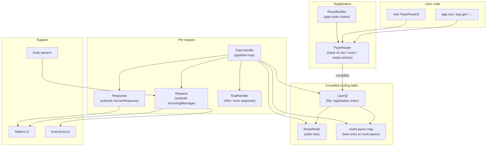
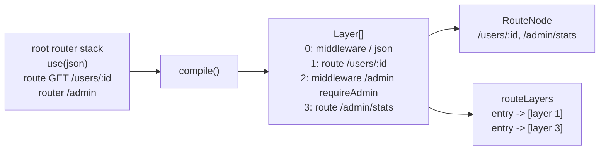
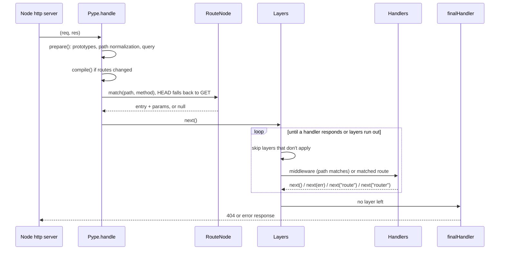
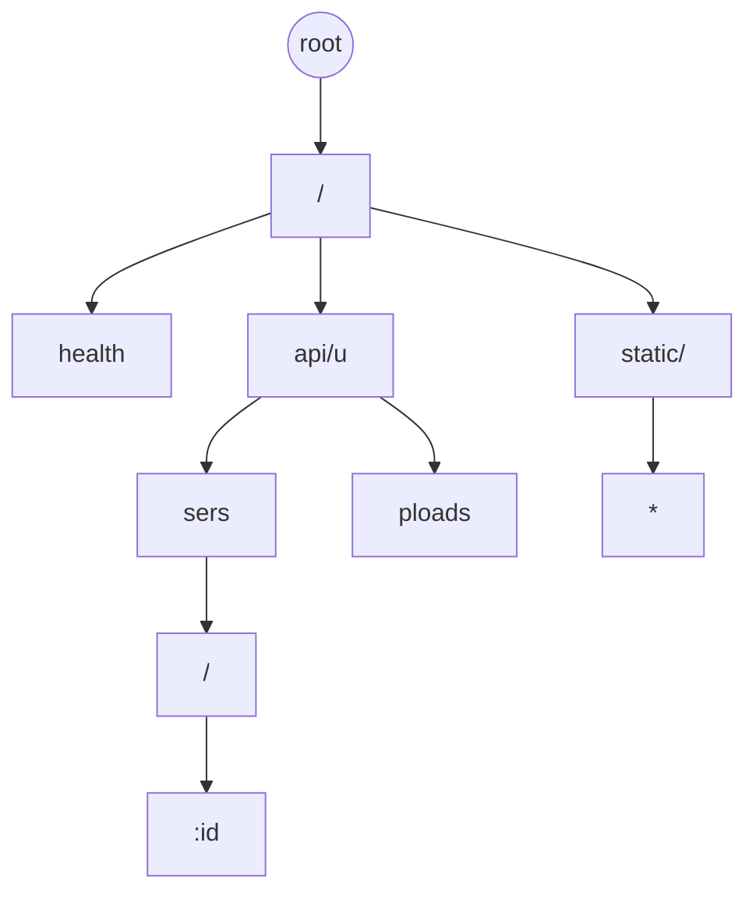
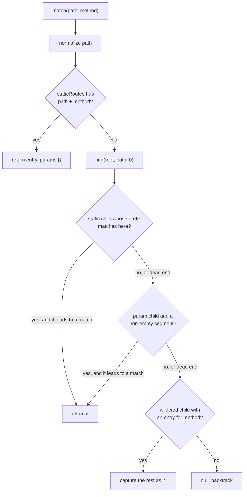
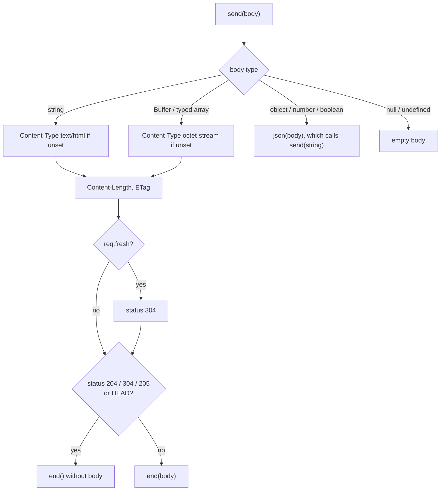
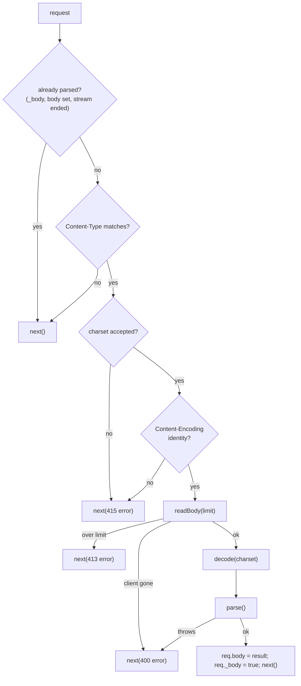

# Pype architecture

This document explains how Pype is built: which component does what, how a
request flows through them, and why the main design decisions were made. It is
written for contributors and for anyone who wants to understand the code
before changing it. For how to *use* the framework, see the
[package README](../packages/core/README.md).

The framework lives in `packages/core` of this monorepo, published to npm as
`pyper-web`. File paths below such as `src/core/server.ts` are relative to
`packages/core`.

## Contents

- [Goals](#goals)
- [Source layout](#source-layout)
- [Component overview](#component-overview)
- [Lifecycle](#lifecycle)
  - [1. Registration](#1-registration)
  - [2. Compilation](#2-compilation)
  - [3. Handling a request](#3-handling-a-request)
- [Components](#components)
  - [Pype: the application and the pipeline](#pype-the-application-and-the-pipeline)
  - [PypeRouter: the registration stack](#pyperouter-the-registration-stack)
  - [RouteNode: the radix tree router](#routenode-the-radix-tree-router)
  - [Request](#request)
  - [Response](#response)
  - [Body parsers](#body-parsers)
  - [Trust proxy](#trust-proxy)
  - [Helpers](#helpers)
  - [Types and Express compatibility](#types-and-express-compatibility)
- [Design decisions](#design-decisions)
- [Security model](#security-model)
- [Performance](#performance)
- [Testing](#testing)
- [Extending Pype](#extending-pype)
- [Known limitations](#known-limitations)
- [Background](#background)

## Goals

1. **Express 5 compatibility.** Existing Express middleware and the Express
   request and response API must work without changes.
2. **Fast routing.** Route lookup must not slow down as the number of routes
   grows, unlike Express, which tests every route in turn.
3. **No runtime dependencies.** Everything Express pulls from ~60 packages is
   implemented in this repository.
4. **Safe defaults.** Parsing of untrusted input (paths, query strings, headers,
   bodies, file paths) must not crash the server or open security holes.

## Source layout

```
src/
  index.ts                  public exports
  core/
    server.ts               Pype: settings, compilation, the request pipeline
    router.ts               PypeRouter: registration stack, flattening to layers
    request.ts              Request: extends http.IncomingMessage
    response.ts             Response: extends http.ServerResponse
    view.ts                 View: finds and renders templates for res.render()
  utils/
    Trie-Route.ts           RouteNode: the radix tree that matches paths
    helpers.ts              negotiation, cookies, ranges, ETags, freshness, query parsing
    qs.ts                   port of the qs parser, for extended forms and queries
    trust-proxy.ts          "trust proxy" setting and X-Forwarded-For handling
  middlewares/
    body-parser.ts          json(), urlencoded(), text(), raw()
  types/                    Middleware, ErrorMiddleware, NextFunction, CookieOptions, ...
  enums/
    methods.enum.ts         HTTP_METHODS
    mime-types.ts           extension to MIME type table
```

| File | Lines | Responsibility |
| ---- | ----- | -------------- |
| `core/server.ts` | ~1180 | Application API, compiling routes, running the pipeline, params, final error handling |
| `core/response.ts` | ~840 | Everything that writes a response: `send`, `json`, `sendFile`, cookies, redirects |
| `utils/helpers.ts` | ~760 | Pure functions shared by request and response |
| `utils/Trie-Route.ts` | ~520 | Path matching |
| `core/router.ts` | ~500 | Collecting middleware and routes in registration order |
| `middlewares/body-parser.ts` | ~470 | Reading and parsing request bodies |
| `core/request.ts` | ~330 | Request properties and content negotiation |
| `utils/trust-proxy.ts` | ~85 | Deciding which proxy headers to believe |

## Component overview



There are two phases:

- **Registration** only records what the user registered, in order, on
  `PypeRouter` objects. Nothing is matched yet.
- **Compilation** turns the routers into a flat list of layers and a radix
  tree. The request pipeline only ever reads this compiled form.

## Lifecycle

### 1. Registration

Every `Pype` app owns one root `PypeRouter`. All registration methods on the
app delegate to it:

```ts
app.use(json());                 // -> router.stack: { type: "use", path: "/", handlers: [json] }
app.get("/users/:id", show);     // -> router.stack: { type: "route", path: "/users/:id", methods: ["get"], handlers: [show] }
app.use("/admin", adminRouter);  // -> router.stack: { type: "router", path: "/admin", router: adminRouter }
```

Each registration increments a module-level counter, `routingVersion()`. That
is how the app knows its compiled table is out of date, including when a
router that is already mounted gets new routes later.

### 2. Compilation

`Pype.compile()` runs in `listen()` and, if the version changed, at the start
of a request. It:

1. Calls `router.compile()`, which walks the stack recursively and produces a
   **flat array of layers in registration order**. Mount paths are joined
   (`/admin` + `/stats` becomes `/admin/stats`), each layer records the chain
   of routers it came from, and an `end` marker follows each mounted router's
   layers.
2. Builds a fresh `RouteNode` (radix tree) and registers every string route
   layer's full path in it. RegExp routes stay out of the tree.
3. Builds `routeLayers`, a map from the tree's entry to the route layers it
   stands for (see [why](#one-tree-entry-many-route-layers)).
4. Builds `fixedLayers`: the layers the tree can't rule out, that is
   middleware, RegExp routes and router ends. A request walks these merged
   with the route layers the tree matched (`dispatchOrder()`), so the cost
   doesn't grow with the number of routes.



Route conflicts (two different param names at the same position) throw here,
so `listen()` reports them at startup.

### 3. Handling a request



The route is looked up **once**, before the pipeline starts. While walking the
layers, a route layer runs only if it is one of the layers the tree matched.
Middleware layers are checked by a prefix comparison, segment by segment when
the mount path has `:params`. When the path contains a `%`, the tree is also
asked which routes match for *other* methods but fail to decode, so those
answer 400 like in Express.

## Components

### Pype: the application and the pipeline

`src/core/server.ts`

The app is a function, like an Express app: the constructor builds a
function that calls `handle()`, gives it the class's prototype and the
fields, and returns it, so `new Pype()` can be passed to
`http.createServer()`. `Pype.prototype` inherits from `Function.prototype`.

#### State

| Field | Purpose |
| ----- | ------- |
| `settings` | Express-style settings. `"trust proxy"` also stores a compiled predicate under `"trust proxy fn"`. |
| `locals` | User data shared across the app. |
| `router` | The root `PypeRouter`. |
| `layers`, `routes`, `routeLayers` | The compiled table, rebuilt by `compile()`. |
| `compiledVersion` | The `routingVersion()` the table was built from. |
| `caseSensitive`, `strict` | The `"case sensitive routing"` and `"strict routing"` settings the table was built with; changing either rebuilds it. With `strict`, the tree keeps trailing slashes, and a router's `"/"` route is registered for its mount path with and without the slash. |

#### `prepare(req, res)`

Runs first for every request:

1. **Prototype upgrade.** `listen()` creates the server with
   `createServer({ IncomingMessage: Request, ServerResponse: Response })`, so
   Node builds Pype objects directly. When Pype runs on someone else's server
   (`http.createServer(app)`, supertest, HTTPS), the plain objects are
   given Pype's prototypes with `Object.setPrototypeOf`.
2. **Per-request state.** Sets `req.app`, `res.app`, `req.res`,
   `req.originalUrl`, `req.baseUrl = ""`, `req.params = {}` and `res.locals`.
3. **Path normalization.** Collapses duplicate slashes in `req.path` and
   `req.url` once. This is a security measure, see
   [Security model](#security-model).
4. **Query parsing.** Only when the URL has a `?`; the result has no
   prototype.

#### The pipeline loop: `handle()` and `next()`

`handle()` builds the request's layer order (`dispatchOrder()`), keeps an
`index` into it and defines `next(err?)`. Each call to `next` advances
`index` to the next layer that applies and runs it:

| Layer kind | Runs when |
| ---------- | --------- |
| Middleware, 3 parameters | No error is pending and `req.path` is under the layer's mount path (and matches its RegExp, at the start and up to a `/`) |
| Middleware, 4 parameters (error middleware) | An error is pending and the path matches |
| Route | No error is pending, and the tree matched the layer, or its RegExp matches the path below its router (HEAD falling back to GET) |
| Router end | An `OPTIONS` request: see below |

Layers of one array path share a `group`; once one of them ran, the others
are skipped, so the route or middleware runs once like a single Express
layer.

Signals passed to `next`:

- `next(err)`: an error is pending; normal middleware is skipped until error
  middleware handles it.
- `next("route")`: the route stops running its handlers and returns to the
  main loop, which continues with the next layer (possibly another route
  registered for the same path).
- `next("router")`: the loop skips every following layer that belongs to the
  innermost router of the layer that called it.

Automatic `OPTIONS` follows Express's router: for an `OPTIONS` request, a
route layer whose path matches but which doesn't handle `OPTIONS` is not run;
its methods are added to its router's `Allow` set instead. When a router is
done, at its `end` marker, after `next("router")`, or for the app at the end
of the loop, it answers with its set if it isn't empty. So a mounted router
answers before middleware registered after it.

When no layer is left, `finalHandler()` responds.

#### `callMiddleware()` and `runRoute()`

Both implement Express's **relative paths**: before calling a middleware
mounted on `/admin`, `mount()` strips `/admin` from `req.url` and `req.path`
and appends it to `req.baseUrl`. The original values are restored when the
middleware calls `next()`. For a mount path with params, `/orgs/:org`, the
matched text of the request is stripped, so `req.baseUrl` is `/orgs/acme`.

Both set `req.params` through `enterParams()`, which follows Express's nested
routers level by level, using the `mounts` a layer was compiled with:

1. For each router above the layer, `req.params` becomes the params of the
   path the next router down is mounted on, merged into the previous level's
   when that router has `mergeParams`. Each level reads its own segments of
   the request, so a name used at two levels keeps both values.
2. The router's `param()` callbacks run for those params
   (`processParams()`, Express's algorithm: once per request and value per
   router, errors and `next("route")` handled like Express). That is how
   `app.param("org")` runs for `app.use("/orgs/:org", router)`.
3. Finally `req.params` becomes the layer's own params (its `:params` or
   RegExp groups), merged when its router has `mergeParams`, and its router's
   callbacks run for them.

`runRoute()` additionally sets `req.route` and runs the route's own handlers
in order with its own inner `next`; a four-parameter handler only gets errors
raised inside the route.

#### `invoke()`: catching errors

Every handler call goes through `invoke()`:

```ts
try {
  const result = err ? handler(err, req, res, next) : handler(req, res, next);
  if (result && typeof result.then === "function") {
    result.then(undefined, (error) => next(error ?? new Error("Rejected promise")));
  }
} catch (error) {
  next(error);
}
```

Synchronous throws and rejected promises both become `next(err)`, like
Express 5. Each `next` passed to a handler is wrapped in `once()`, so a second
call only logs a warning instead of running the rest of the pipeline twice,
as Express does. When that second call passes an error, the warning includes
it, so it isn't lost.

#### `finalHandler()`

Mirrors Express's `finalhandler` package:

- No error and the response already started: do nothing.
- No error: `404 {"error":"Cannot GET /path","status":404}`.
- Error: status from `err.status` or `err.statusCode` (400–599, else 500).
  Only 4xx messages are exposed. Existing headers are cleared, `err.headers`
  are applied, and the error is logged unless `env` is `"test"`.
- If headers were already sent, the socket is destroyed, because the
  response can't be completed meaningfully.

### PypeRouter: the registration stack

`src/core/router.ts`

A router is just an ordered list of entries:

```ts
type StackEntry =
  | { type: "use"; path; handlers }       // middleware
  | { type: "router"; path; router }      // a mounted sub-router
  | { type: "route"; path; methods; handlers };
```

- `use()` flattens nested arrays (Express allows `use([a, [b, c]])`), splits
  a mixed list like `use("/x", mw, router, mw2)` into consecutive entries, and
  validates that every argument is a function or a router.
- The route methods (`get`, `post`, ..., `all`) flatten handler arrays and
  push a `route` entry.
- `route(path)` returns a `RouteBuilder`, a thin object whose methods call
  the router's methods with the stored path.
- `new PypeRouter({ mergeParams: true })` sets `mergeParams`, read by
  `enterParams()`.

`compile(basePath, routers, mounts)` produces the layers:

```ts
interface MiddlewareLayer {
  kind: "middleware";
  path; pattern?; handle; routers; group?;
  keys;       // param names of its own mount path
  mounts;     // MountScope[]: each router above it, with its mount path's param names
}
interface RouteLayer {
  kind: "route";
  fullPath;   // used for matching, e.g. "/admin/stats"; the router's mount for a RegExp
  routePath;  // as written, e.g. "/stats", a RegExp or an array, exposed as req.route.path
  pattern?;   // a RegExp path, used without its g and y flags so lastIndex can't leak between requests
  baseUrl;    // mount path, e.g. "/admin", exposed as req.baseUrl
  keys;       // param names of the route's own path, for param() callbacks
  mounts;     // as for middleware
  methods; handlers; routers; group?;
}
interface RouterEndLayer { kind: "end"; router; routers }
```

Paths can be strings, RegExps or arrays. Each element of an array becomes its
own layer and they share a `group`. A router mounted on several paths is
compiled once per path, and copy `i` of each layer shares a group. Mounting a
router on a RegExp throws, since its layers' paths must be known when the
tree is built. `param()` stores callbacks in `params` by name.

`routers` is the chain of routers a layer came from, outermost first. It is
what lets `next("router")` know which layers to skip.

### RouteNode: the radix tree router

`src/utils/Trie-Route.ts`

#### Structure

A radix tree (compressed trie) stores runs of static characters in single
nodes instead of one node per segment or per character. Each `Node` has:

| Field | Meaning |
| ----- | ------- |
| `prefix` | The static text this node consumes, e.g. `"api/"` |
| `childCodes`, `staticChildren` | Static children, found by the first char code of their prefix |
| `paramChild`, `paramName` | A child that consumes one `:param` segment |
| `wildcardChild` | A child that consumes the rest of the path |
| `entries` | Routes ending here, keyed by HTTP method |
| `buildParams` | A compiled function that builds `req.params` |

For the routes `/`, `/health`, `/api/users`, `/api/users/:id`,
`/api/uploads` and `/static/*`:



`/api/users` and `/api/uploads` share the node `api/u`; adding `/api/uploads`
**split** the earlier `api/users` node into `api/u` + `sers`.

#### Registration: `register()`, `insert()`, `insertStatic()`

1. `validateUrl()` rejects paths that don't start with `/`, `?` or `*`
   anywhere but the end, and `:` anywhere but at the start of a segment
   holding a single `:name` or `:name?` (`PARAM_SEGMENT`).
2. `normalize()` applies the slash options.
3. An optional last parameter is expanded: `/users/:id?` registers `/users`
   **and** `/users/:id` with the same handlers.
4. `tokenize()` splits the path into static text, `:param` and `*` tokens:
   `/users/:id/files/*` becomes static `/users/`, param `id`, static `/files/`,
   wildcard.
5. `insert()` walks the tokens. Static tokens go through `insertStatic()`,
   which follows matching children and splits a node where prefixes diverge.
   A param token reuses the node's `paramChild` and throws
   `parameter name conflict` if an existing one has a different name.
6. The final node stores the entry for the method (throwing
   `Duplicate routes at: ...` if there already is one), and a compiled
   `buildParams` function.
7. Paths without params or wildcards are also stored in `staticRoutes`, a
   `Map<path, Map<method, entry>>`.

#### Matching: `match()` and `find()`



`find()` is a depth-first search that tries **static, then param, then
wildcard** at every node and backtracks when a branch fails deeper down. That
is why `/users/new/edit` reaches `/users/:id/edit` even though the static
`/users/new` route exists. Param values are collected in an array and popped
when backtracking. A wildcard can match an empty rest (`/files/` for
`/files/*` when trailing slashes are kept).

Exact static paths skip the tree completely through `staticRoutes`. This is
correct because an exact static match always wins under the precedence
rules.

With `caseSensitive: false` (the `"case sensitive routing"` setting turned
off), static text is stored lowercased and the request path is compared
lowercased, while param values are cut from the original path, so they keep
their case. Only ASCII letters are folded (`lowerAscii()`), so both strings
have the same length and positions line up.

#### Building params

`compileParamsBuilder()` generates one function per route with
`new Function`:

```js
(v, d) => ({ "id": d(v[0]), "postId": d(v[1]) })
```

Every match then creates an object of the same shape, which V8 optimizes far
better than adding keys one by one. Names come from route definitions and are
JSON-escaped, so request data never reaches generated code. `decode()` only
calls `decodeURIComponent` when the value contains `%`. A malformed escape
throws a 400 `URIError`; `match()` catches it and returns it as
`MatchResult.error` with empty params, and `Pype.handle()` then skips the
route layers and passes the error on, like Express, for every method.

### Request

`src/core/request.ts`

`Request` extends Node's `IncomingMessage`, so all of Node's request API is
still there. It adds:

- **Plain fields** set by the pipeline: `params`, `query`, `body`, `path`,
  `originalUrl`, `baseUrl`, `route`, `app`, `res`, `next`. Fields used by
  middleware packages are declared too: `cookies`, `signedCookies`, `secret`
  (cookie-parser) and `_body` (body parsers). `cookies` deliberately stays
  `undefined` until `cookie-parser` sets it, because cookie-parser skips
  requests that already have it.
- **Getters** computed on access, so requests that don't use them pay
  nothing: `protocol`, `secure`, `ip`, `ips`, `host`, `hostname`,
  `subdomains`, `xhr`, `fresh`, `stale`.
- **Methods**: `get`/`header`, `accepts*`, `is`, `range`.

Content negotiation (`accepts`, `acceptsCharsets`, `acceptsEncodings`,
`acceptsLanguages`) is built on the `preferred*()` functions in `helpers.ts`,
and `is()` on `mediaTypeOf()` and `matchContentType()`; see
[Helpers](#helpers). `hasBody()` follows `type-is`: a `Transfer-Encoding` or
any numeric `Content-Length`, including 0. The proxy-aware getters ask the app's `"trust proxy fn"`
whether the socket peer is trusted before reading `X-Forwarded-*` headers;
see [Trust proxy](#trust-proxy).

`fresh` returns `false` immediately for requests without `If-None-Match` or
`If-Modified-Since`. Only conditional requests read the response headers.

### Response

`src/core/response.ts`

`Response` extends `ServerResponse<Request>`. Header helpers (`set`, `get`,
`append`, `type`, `vary`, `location`, `links`, `attachment`, `cookie`,
`clearCookie`, `status`) only change headers and return `this`. Four methods
send the response: `send`, `json`, `redirect` and `sendFile`.

#### `send()`



String bodies stay strings until `end()`. Node can then write the headers and
the body in a single socket write, which was measurably faster than converting
to a `Buffer` first.

#### `sendFile()`

1. `resolveFilePath()` rejects null bytes (400), `..` segments and paths that
   resolve outside `root` (403), and applies the dotfile policy.
2. `transferFile()` **opens the file first** and works from that descriptor
   only (`fstat`, then the read stream), so the file that was checked is the
   file that is sent. Missing files become 404, directories an `EISDIR`
   error. With `followSymlinks: false`, `checkRealPath()` then resolves the
   real paths of the file and the root, answers 403 if the file is outside,
   and checks that the real path inside the root is the opened file (same
   device and inode). A path swapped for a symlink during the request
   therefore gets a 403, never the other file.
3. `setFileHeaders()` sets `Content-Type`, `Accept-Ranges`, `Cache-Control`,
   `Last-Modified` and a weak `ETag` built from size and modification time.
4. A failing `If-Match` or `If-Unmodified-Since` gets 412 and fresh
   conditional requests 304. A single satisfiable `Range` gets 206 with
   `Content-Range`, unless an `If-Range` no longer matches, which sends the
   whole file; an unsatisfiable range gets 416 with `Content-Range: bytes */<size>`.
5. The file is streamed with `stream.pipeline(createReadStream(..., { fd }), res)`,
   which closes the file when the client disconnects. A plain `pipe()` would
   leak a file descriptor per aborted download. Every early return (304, 412,
   416, HEAD, empty files) closes the descriptor itself.
6. Errors go to the callback when one is given. Otherwise, like Express, a
   client that disconnected is ignored, a directory calls `next()`, and any
   other error is passed to `next(err)` as an `HttpError` with the status and
   the file system `code`. A fresh error is used so file paths don't end up in
   a message the final handler would show.

`download()` resolves the path, sets `Content-Disposition` and delegates to
`sendFile()`.

#### Cookies

`cookie()` serializes objects as `j:` + JSON (the cookie-parser convention),
signs values with the `cookie-parser` secret when `signed` is set (same format
as the `cookie-signature` package), and calls `serializeCookie()`, which
validates the name, the encoded value, `domain` and `path` so values can't
inject attributes into `Set-Cookie`.

### Body parsers

`src/middlewares/body-parser.ts`

All four parsers come from one factory, `createParser(config, options, parse)`,
where `config` holds the default type and which charsets the parser accepts:



- `readBody()` rejects early when `Content-Length` is above the limit, stops
  reading as soon as the received bytes pass it, and rejects with a 400
  `request.aborted` when the client disconnects first, like `raw-body`.
- `decode()` turns the bytes into text: ISO-8859-1 byte for byte, UTF-32 by
  hand, everything else with `TextDecoder`, dropping a byte order mark like
  `iconv-lite`.
- `urlencoded()` uses `parseForm()`, the rules of `qs` at depth 0 that
  `body-parser` applies with `extended: false`.
- The "already read" check matters: the `body-parser` package marks bodies by
  consuming the stream, and waiting on an ended stream would hang forever.
- Errors are `BodyParseError`s with `status`, `statusCode`, `expose` and
  `type`, the same shape as `body-parser` errors, so error middleware written
  for Express handles them.

### Trust proxy

`src/utils/trust-proxy.ts`

`app.set("trust proxy", value)` stores the value and compiles it with
`compileTrust()` into a predicate `(address, hop) => boolean`:

| Value | Predicate |
| ----- | --------- |
| `true` / `false` | Always / never |
| number `n` | `hop < n` |
| string or array of IPs, CIDRs, `loopback`, `linklocal`, `uniquelocal` | Membership in a `net.BlockList` |
| function | Used as is |

`trustedAddresses()` implements the algorithm of Express's `proxy-addr`: start
with the socket address, append the `X-Forwarded-For` entries from right to
left, and stop at the first address that isn't trusted. `req.ip` is the last
address of that list, and `req.ips` the list without the socket address,
client first.

### Helpers

`src/utils/helpers.ts` contains pure functions, which keeps `Request` and
`Response` small and makes the logic easy to test directly:

| Function | Used by | What it does |
| -------- | ------- | ------------ |
| `preferredMediaTypes()`, `preferredCharsets()`, `preferredEncodings()`, `preferredLanguages()` | `req.accepts*`, `res.format` | The algorithms of `negotiator` 1.x, which Express's `accepts` uses |
| `mediaTypeOf()`, `matchContentType()`, `lookupMime()` | `req.is`, body parsers | `type-is` rules: valid media types, extensions, `*/*`, `+suffix`, `urlencoded`, `multipart` |
| `normalizeType()`, `contentType()`, `setCharset()` | `res.type`, `res.set`, `res.send` | `Content-Type` values with the charsets Express adds |
| `parseTokenList()` | `isFresh()`, `res.vary` | Comma-separated header lists |
| `parseRange()` | `req.range`, `sendFile` | Parses `Range`, optionally merging ranges in the order they were asked for, like `range-parser` |
| `isFresh()` | `req.fresh` | `If-None-Match` / `If-Modified-Since` rules of the `fresh` package |
| `isPreconditionFailure()`, `isRangeFresh()` | `sendFile` | `If-Match` / `If-Unmodified-Since` and `If-Range` rules of Express's `send` |
| `generateETag()`, `generateStrongETag()` | `res.send` | ETags `W/"<size>-<sha1>"` and `"<size>-<sha1>"`, like Express's `"etag"` setting |
| `serializeCookie()`, `signCookie()` | `res.cookie` | Validated `Set-Cookie` values and signatures |
| `encodeUrl()`, `escapeHtml()` | `res.location`, `res.redirect` | Safe URLs and HTML |
| `contentDisposition()` | `res.attachment`, `res.download` | `content-disposition` rules: token, quoted or RFC 5987 file names |
| `parseQuery()` | `prepare()` | Node's `querystring.parse`, Express 5's default query parser |

The `preferred*()` functions give each offer the q-value of the **most
specific** client preference that matches it (a bitmask: type, subtype and
parameters for media types; exact, prefix and `*` for languages), so
`text/html;q=0, */*` refuses `text/html` even though `*/*` would accept it.
Ties are broken by specificity, the client's order, then the server's.
Without offers they list the accepted values with the client's spelling.
`preferredEncodings()` adds an implied `identity` with the header's lowest
q-value unless a preference already covers it.

### Types and Express compatibility

- **Handler types** (`src/types`): `Middleware`, `ErrorMiddleware` (four
  parameters), `RouteHandler` and `AnyHandler` (any function).
- **Overloads.** `use()` and the route methods are overloaded: the first
  overloads take Pype's typed handlers, so inline functions get `req` and
  `res` inferred; the last overloads accept `AnyHandler`, so middleware typed
  against Express's own types is accepted too.
- **Type augmentation.** `request.ts` declares an empty global
  `Express.Request` / `Express.Response` and merges them into Pype's classes.
  Packages that augment Express's types (`req.user` from passport, `req.file`
  from multer) therefore augment Pype's types as well.
- **Runtime compatibility** comes from behaving like Express where middleware
  depends on it: `req.app.get("trust proxy")`, `req.originalUrl`,
  `req.baseUrl`, relative `req.url` inside mounted middleware, `res.locals`,
  error middleware arity, and `req.cookies` staying undefined until
  cookie-parser runs.

## Design decisions

### Specificity instead of registration order for routes

Express tests routes one by one in registration order, so lookup cost grows
with the number of routes, and the first match wins. Pype looks up the route
once in the radix tree, so cost depends on the path length, not the route
count, and the most specific pattern wins. Middleware still runs in
registration order, so the visible behaviour only differs when two
*different* patterns match the same URL.

### One tree entry, many route layers

Express allows several routes for the same method and path (used with
`next("route")`). The tree can store only one entry per method and path, so
`compile()` registers an empty array as the entry for each method and path,
and `routeLayers` maps that array to every route layer registered for it. The
pipeline then runs those layers in their registration order.

### Compiling instead of matching the stack directly

Matching against the router stack on every request would mean walking nested
routers and joining mount paths each time. Compiling once into a flat array
and a tree moves that work to startup. The global `routingVersion()` counter
keeps late registrations working without making every router hold a
reference to every app.

### Prototypes instead of decorating each request

Earlier versions copied functions onto every request and response object.
Passing subclasses to `createServer` puts the methods on the prototype once,
which is faster and gives TypeScript real classes.

### No runtime dependencies

Every helper Express takes from npm (`body-parser`, `qs`, `send`, `cookie`,
`proxy-addr`, `fresh`, `range-parser`, `negotiator`, `type-is`, ...) is
implemented here. The `qs` parser is a port (`utils/qs.ts`, with its BSD
licence notice), fuzzed against the real package. This keeps
installs small (one package, about 0.5 MB) and the supply-chain surface to
this repository. Behaviour is checked against the original packages in the
tests where it matters, for example cookie signatures against
`cookie-signature`.

## Security model

| Threat | Defence | Where |
| ------ | ------- | ----- |
| Skipping auth middleware with `//admin/secret` | Duplicate slashes are collapsed once, before both middleware and route matching | `Pype.prepare()` |
| `?__proto__=...` changing objects | Query and form objects have no prototype | `parseQuery()` |
| Header injection through cookies | Names, values, domain and path are validated; `sameSite` and `priority` must be known values | `serializeCookie()` |
| Path traversal in `sendFile` | `..` segments and paths outside `root` give 403, null bytes 400 | `resolveFilePath()` |
| Hidden files leaking | Dotfiles ignored (404) by default | `resolveFilePath()` |
| Symlinks leading out of `root` | Opt-in with `followSymlinks: false`: the real path must stay inside the real root and be the file that was opened, 403 otherwise, so swapping in a symlink during the request doesn't work. Hard links aren't detected. Followed by default, like Express | `transferFile()`, `checkRealPath()` |
| Large or slow bodies | Size limit checked on `Content-Length` and while reading; a `NaN` limit throws instead of disabling it | `readBody()` |
| File descriptor exhaustion | Files closed when clients disconnect | `sendFile()` with `stream.pipeline` |
| Spoofed client IPs | `X-Forwarded-*` only read from trusted proxies, off by default | `trust-proxy.ts` |
| Leaking error details | Only 4xx messages are sent to clients | `finalHandler()` |
| Code injection in compiled params | Param names are JSON-escaped; request data is never part of generated code | `compileParamsBuilder()` |

`tests/security.test.ts` has regression tests for each, and
`tests/fuzz.test.ts` checks the traversal and middleware bypass properties
with random paths over real HTTP.

## Performance

What makes the hot path fast:

- **Static routes** are one `Map` lookup (about 55 ns).
- **Dynamic routes** walk only the nodes on their path; child lookup is a
  small array scan, and prefix comparison a char-code loop, both faster than
  `Map` and `startsWith` in V8 for these sizes.
- **Params** are built by a precompiled, fixed-shape function.
- **Lazy work**: query parsing only with a `?`, request getters only when
  read, freshness checks only for conditional requests.
- **One write per response** for string bodies.

Profiling under load shows Pype's own code at under 10% of server CPU; the
rest is Node's HTTP parser and the kernel. Use `npm run bench` (HTTP, against
Express and bare Node) and `npm run bench:router` (lookups only) to measure
changes.

## Testing

| File | Covers |
| ---- | ------ |
| `tests/trie.test.ts` | Route registration, matching, precedence, normalization |
| `tests/server.test.ts` | Core pipeline over HTTP |
| `tests/request-response.test.ts` | Request and response API |
| `tests/response-api.test.ts` | Every response method, `sendFile` edge cases |
| `tests/app-api.test.ts` | Application API, routing API, error handling, body parsers |
| `tests/express-compat.test.ts` | Real Express middleware packages and pipeline semantics |
| `tests/trust-proxy.test.ts` | Trust settings and forwarded headers |
| `tests/helpers.test.ts` | Helper functions directly |
| `tests/security.test.ts` | Regression tests for security fixes |
| `tests/fuzz.test.ts` | Property-based tests with fast-check |
| `tests/differential.test.ts` | The same routes on Express 5 and Pype; every request, including fuzzed headers and bodies, must get the same status, headers and body. Known differences are asserted separately, so a change in them fails too |
| `tests/http-edge.test.ts` | Raw socket checks against both frameworks: HEAD, 204 and 304 without body bytes, keep-alive, pipelining, aborted bodies and downloads, `100-continue`, half-closed connections, malformed requests |
| `tests/support/http.ts` | Shared client that starts an app on a free port |

`tests/trie.test.ts` also checks the router against a reference model of the
precedence rules with generated route sets, matches 10,000 routes, and
times a lookup that has to backtrack through overlapping branches.

Coverage thresholds (95% statements, functions and lines, 90% branches) are
enforced by `vitest.config.ts`. CI runs type checks, tests and a package
build on Linux, macOS and Windows with Node 22, 24 and 26; a nightly workflow runs
`npm run test:fuzz`, 20,000 runs per property.

## Extending Pype

**A new response helper.** Add a method to `Response` in
`src/core/response.ts`; put any parsing or formatting logic in `helpers.ts` as
a pure function with its own tests. Header helpers should return `this`.

**A new request property.** Prefer a getter in `src/core/request.ts` so
requests that don't read it pay nothing. If it depends on settings, read them
through `this.app?.settings`.

**A new setting.** Give it a default in the `Pype` constructor. If it needs
preprocessing (like `"trust proxy"`), compute it in `set()` and store the
result under a separate key.

**HTTP methods.** Every method in Node's `http.METHODS` gets a route
method on `PypeRouter`, `RouteBuilder` and `Pype`, added to their prototypes
from `METHODS` (`enums/methods.enum.ts`); the common ones are written out.
New Node methods are picked up automatically, and `ExtraMethod` lists the
others for TypeScript.

**Router features.** Matching lives entirely in `RouteNode`. Keep the
precedence order (static, param, wildcard) and backtracking, run
`tests/trie.test.ts` and the fuzz tests, and compare `npm run bench:router`
before and after.

## Known limitations

- Route patterns are the Express 4 style (`:id?`, `*`), not Express 5's
  `{/:id}` and `/*splat`.
- Routing is case-sensitive by default, unlike Express; `"case sensitive
  routing": false` and `"strict routing"` cover every router, there are no
  per-router `caseSensitive` and `strict` options.
- No several params in one segment, routers mounted on a RegExp, or mounting
  another app with `app.use(otherApp)`.
- No `res.jsonp`.

## Background

### Why Pype exists

Pype started as a learning project. After several years of building Node.js
backends with Express and NestJS, the goal was to understand what these tools
do behind the scenes, because treating a framework as a black box makes
middleware problems and performance bottlenecks much harder to debug. Building
one from the raw `http` module up makes `next()`, middleware chains, route
matching and the request lifecycle explicit.

### From the first plan to the current design

The first design, written before any code, aimed for readability over
performance and listed production readiness and replacing Express as
non-goals. The project then grew into an Express 5 compatible framework, and
several ideas changed on the way:

| First plan | What was built |
| ---------- | -------------- |
| Wrapper objects with `req.raw` and `res.raw` | Subclasses of `IncomingMessage` and `ServerResponse`, see [Prototypes instead of decorating each request](#prototypes-instead-of-decorating-each-request) |
| A `req.context` store | `res.locals`, like Express |
| Interceptors around handlers (`await next()`) | Left out: Express middleware semantics instead |
| `*` for one segment, `**` for many | Express 4 style `:id?` and a trailing `*` |
| First matching route wins | The most specific route wins, see [Design decisions](#design-decisions) |
| `PipeServer` and `PipeRouter`, routes registered into the tree when a router is mounted | `Pype` and `PypeRouter`, routers compiled into layers and a tree, see [Compilation](#2-compilation) |
| Guard against multiple `next()` calls | Kept: a second call is ignored with a warning |
| Configurable case sensitivity | The `"case sensitive routing"` setting |

The checklist of Express request and response methods from that time is now
covered by the [package README](../packages/core/README.md), which documents
every method.

### Planned write-ups

The project was also meant to be documented as a blog series, from Node's
HTTP layer (`http.createServer`, `IncomingMessage`, `ServerResponse`, streams,
the request lifecycle) through router design and its data structures,
benchmarks, wrapping the request and response, Express compatibility, the
middleware engine and error handling, to design patterns, mistakes made and
lessons learned. This document covers the technical parts of that plan.
